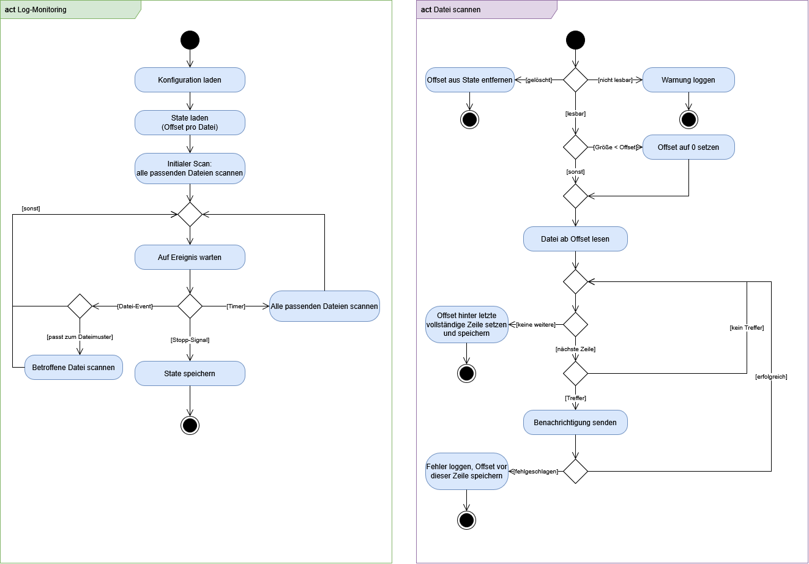
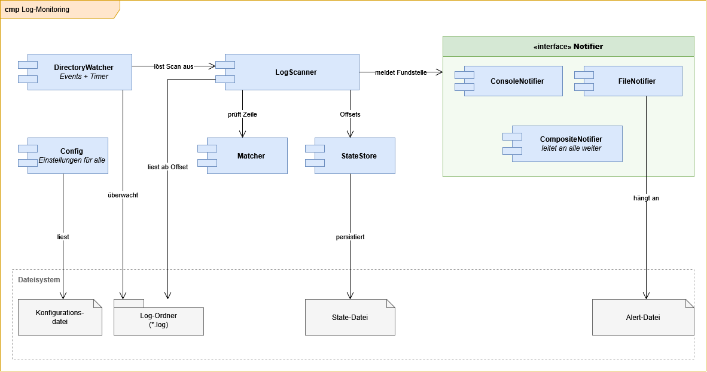

# log-monitor

[](https://github.com/NilsTheRock/log-monitor/actions/workflows/build.yml)

Überwacht einen Ordner mit Log-Dateien und meldet jede neu hinzugekommene Zeile, die „ERROR“
enthält – auf der Konsole und in einer Alert-Datei.

## Aufgabe

Externe Komponenten legen ihre Log-Dateien in einem Ordner ab. Taucht in einer dieser Dateien das
Wort „ERROR“ auf, soll eine Benachrichtigung ausgelöst werden. Umzusetzen sind drei Schritte:

1. einen vorgegebenen Ordner überwachen oder einmalig nach Log-Dateien durchsuchen,
2. die gefundenen Log-Dateien nach „ERROR“ durchsuchen,
3. bei Fundstellen eine Benachrichtigung auslösen (Art der Benachrichtigung frei wählbar).

Umgesetzt ist die Variante **überwachen**: Der Prozess läuft dauerhaft und meldet eine Fundstelle,
sobald sie geschrieben wird. Ein einmaliges Durchsuchen wäre kein Monitoring, sondern ein Ersatz
für `grep -rlw ERROR`.

## Annahmen

- Log-Dateien sind UTF-8-Textdateien, zeilenbasiert und werden nur **angehängt**, nicht
  nachträglich verändert.
- Überwacht wird **nur der konfigurierte Ordner**, keine Unterordner.
- „ERROR“ wird **case-sensitive und mit Wortgrenzen** gesucht (`\bERROR\b`). `NO_ERROR`, `ERRORS`,
  `error` und `ErrorHandler` sind damit keine Fundstellen.
- Jede Fundstelle wird **genau einmal** gemeldet, auch über Neustarts hinweg. Ausnahme ist eine
  fehlgeschlagene Benachrichtigung, siehe [Fehlerfall](#fehlerfall-at-least-once).
- Verarbeitet werden nur **vollständige Zeilen** (mit Zeilenumbruch). Eine halb geschriebene letzte
  Zeile wird beim nächsten Scan verarbeitet.
- **Erststart ohne State:** Offset 0, es werden also auch alle bereits vorhandenen ERROR-Zeilen
  gemeldet. Das ist bewusst so – ein Monitoring soll nichts stillschweigend überspringen.

## Lösungsentwurf





Die Quellen der Diagramme (`.drawio`) und SVG-Exporte liegen ebenfalls in
`docs/diagrams/`. Die Komponente `Matcher` aus dem Diagramm heißt im Code `LineMatcher`,
um eine Namenskollision mit `java.util.regex.Matcher` zu vermeiden.

| Komponente              | Verantwortung                                                                                 |
|-------------------------|-----------------------------------------------------------------------------------------------|
| `LogMonitorApplication` | Einstiegspunkt: Konfiguration laden, Komponenten verdrahten, Watcher starten, Shutdown-Hook   |
| `Config`                | Alle Einstellungen; Defaults, Properties-Datei, CLI-Overrides, Validierung                    |
| `DirectoryWatcher`      | `WatchService` und Timer; gibt Scan-Aufträge an den Executor                                  |
| `LogScanner`            | Scannt eine Datei ab dem gespeicherten Offset und meldet Treffer                              |
| `LineMatcher`           | Kapselt das kompilierte Regex-Pattern                                                         |
| `StateStore`            | Scan-Fortschritt pro Datei laden und persistieren                                             |
| `FileState`, `Finding`  | Datensätze für Fortschritt bzw. Fundstelle                                                    |
| `Notifier`              | Schnittstelle für Benachrichtigungen (`ConsoleNotifier`, `FileNotifier`, `CompositeNotifier`) |

## Designentscheidungen

### Sprachwahl

Betrachtet wurden Java, Python und Bash; C# und PowerShell sind mangels eigener Erfahrung außen
vor. Java und Python liegen fachlich nah beieinander – den Ausschlag gibt der Bezug zur Stelle.

- **Java** – *Pro:* `WatchService` ist in der Standardbibliothek, also event-basierte Überwachung
  ohne Fremdbibliothek; statische Typisierung und Interfaces führen zu einer klar geschnittenen,
  gut testbaren Struktur; ausgereiftes Tooling (Maven, JUnit); plattformunabhängig; die
  JVM-Startzeit fällt bei einem dauerhaft laufenden Prozess nicht ins Gewicht.
  *Contra:* mehr Boilerplate; Build-Setup ist für eine kleine Aufgabe Overhead; JRE nötig.
- **Python** – *Pro:* kompakt und gut lesbar; Regex und `pathlib` in der Standardbibliothek,
  Polling ohne Fremdbibliothek möglich. *Contra:* event-basierte Überwachung braucht `watchdog`;
  dynamische Typisierung; Interpreter bzw. venv nötig.
- **Bash** – *Pro:* ideal für die einmalige Suche (`grep -rlw ERROR`), unter Linux ohne Setup.
  *Contra:* unter Windows nicht nativ; Überwachen nur mit `inotifywait` (Linux-only, nicht
  vorinstalliert) oder einer Polling-Schleife; State, Fehlerbehandlung und Tests sind umständlich.

### Hybride Überwachung

Drei Auslöser greifen zusammen:

1. **Initialer Scan** beim Start – damit Fundstellen aus der Zeit vor dem Start nicht verloren
   gehen.
2. **`WatchService`-Events** (`ENTRY_CREATE`, `ENTRY_MODIFY`, `ENTRY_DELETE`) – die Meldung erfolgt
   unmittelbar, kein Polling-Intervall als Verzögerung.
3. **Periodischer Komplett-Scan** (Default 60 s) – Sicherheitsnetz. Events können ausbleiben, etwa
   auf Netzlaufwerken, und bei `OVERFLOW` meldet das Betriebssystem nur, dass Events verloren
   gingen. Der Timer-Scan holt solche Änderungen verlässlich nach.

Alle Scans laufen über **einen single-threaded `ScheduledExecutorService`**. Damit kann kein Scan
parallel zu einem anderen laufen und der Zustand braucht keine Synchronisierung – eine Entscheidung
gegen Race Conditions statt für Locks.

### State: Byte-Offset pro Datei

Pro Datei werden **Byte-Offset und Zeilenanzahl** gespeichert und nach jedem Datei-Scan
persistiert. Der nächste Scan liest ab dem Offset weiter, statt die Datei erneut komplett zu lesen:

- keine Doppelmeldungen, auch nach einem Neustart,
- die Laufzeit hängt an der Menge **neuer** Zeilen, nicht an der Dateigröße,
- die Zeilenanzahl liefert die Zeilennummer für die Meldung.

Gelesen wird **gestreamt** (`FileChannel` ab Offset, gepuffert), eine große Datei landet also nie
komplett im Speicher. Getrennt wird am Byte `\n`, erst die vollständige Zeile wird als UTF-8
dekodiert – so wird kein Multibyte-Zeichen zerschnitten. Ein abschließendes `\r` wird entfernt,
damit CRLF-Dateien aus Windows dasselbe Ergebnis liefern.

Ist eine Datei **kleiner als der gespeicherte Offset**, gilt sie als rotiert oder geleert und wird
wieder von vorn gescannt. Die State-Datei wird **atomar** geschrieben (Temp-Datei im selben Ordner,
dann `ATOMIC_MOVE`), damit ein Abbruch während des Schreibens keinen halben Zustand hinterlässt.

### Matching

Regex statt `String.contains`, Default `\bERROR\b`, case-sensitive. Die Wortgrenzen schließen
`NO_ERROR`, `ERRORS` und `ErrorHandler` aus, die Groß-/Kleinschreibung zusätzlich `error` in
Prosa-Meldungen. Über `match.pattern` ist das Muster frei konfigurierbar, der Rest des Programms
bleibt unverändert.

### Notifier-Interface

`Notifier` hat genau eine Methode:

```java
void notify(Finding finding) throws NotificationException;
```

Der Scanner kennt nur dieses Interface, nicht den Kanal. `ConsoleNotifier` und `FileNotifier`
nutzen dieselbe Formatierungsmethode (`Finding.format()`), Konsole und Alert-Datei enthalten also
identischen Text:

```
[2026-10-12 14:03:11] Match in app.log (line 42): 2026-10-12 14:03:10 ERROR [payment-gateway] database connection lost
```

Auf einem Terminal färbt der `ConsoleNotifier` den Kopf der Meldung (bis einschließlich
`(line 42):`) grün, die Log-Zeile selbst bleibt ungefärbt. Wird die Ausgabe umgeleitet oder ist
`NO_COLOR` gesetzt, entfällt die Farbe.

Der `CompositeNotifier` verteilt an mehrere Kanäle. Ein Mail- oder Teams-Notifier wäre eine neue
Implementierung des Interfaces, ohne Änderung an Scanner oder State.

### Konfiguration

Properties-Datei, einzelne Werte per CLI-Argument überschreibbar; Reihenfolge
**Defaults → Properties-Datei → CLI**. Damit lässt sich eine feste Betriebskonfiguration ablegen
und für einen Testlauf punktuell abweichen, ohne die Datei zu bearbeiten. Die Konfiguration wird
beim Start validiert (Ordner vorhanden, Regex kompilierbar, Intervall > 0) und bricht im Fehlerfall
mit klarer Meldung und Exit-Code 1 ab.

### Fehlerfall: at-least-once

Schlägt eine Benachrichtigung fehl, wird der Offset auf den **Anfang dieser Zeile** gesetzt und der
Scan der Datei abgebrochen. Die Zeile wird beim nächsten Scan erneut gemeldet: lieber eine doppelte
Meldung als eine verlorene. Bekannter Trade-off beim `CompositeNotifier` – hat ein Kanal die Zeile
schon erfolgreich verarbeitet und ein weiterer schlägt fehl, sieht der erste Kanal die Zeile beim
nächsten Scan ein zweites Mal.

## Build

Voraussetzung ist ein JDK 21. Maven selbst muss nicht installiert sein, der Wrapper lädt es:

```bash
./mvnw verify          # Windows: mvnw.cmd verify
```

Ergebnis ist das ausführbare `target/log-monitor.jar`.

## Ausführen

```bash
java -jar target/log-monitor.jar --config=config/log-monitor.example.properties
java -jar target/log-monitor.jar --watch.directory=/var/log/meine-komponente
java -jar target/log-monitor.jar --help
```

Beendet wird mit `Ctrl+C`; der Shutdown-Hook wartet auf einen noch laufenden Scan.

## Konfiguration

| Key                     | Default                         | Bedeutung                                 |
|-------------------------|---------------------------------|-------------------------------------------|
| `watch.directory`       | – (Pflicht)                     | Zu überwachender Ordner, ohne Unterordner |
| `file.pattern`          | `*.log`                         | Glob auf den Dateinamen                   |
| `match.pattern`         | `\bERROR\b`                     | Regex, case-sensitive                     |
| `scan.interval.seconds` | `60`                            | Intervall des periodischen Komplett-Scans |
| `alert.file`            | `alerts.log`                    | Ziel des `FileNotifier`                   |
| `state.file`            | `.log-monitor-state.properties` | Datei mit dem Scan-Fortschritt            |

Jeder Key ist auch als CLI-Argument nutzbar (`--scan.interval.seconds=10`) und überschreibt dann
die Properties-Datei. Relative Pfade gelten relativ zum Arbeitsverzeichnis. Unbekannte Keys werden
mit einer Warnung ignoriert.

**Achtung:** In einer Properties-Datei muss der Backslash escaped werden. Das Default-Muster wird
dort also als `\\bERROR\\b` geschrieben – siehe
[`config/log-monitor.example.properties`](config/log-monitor.example.properties).

## Demo

Die Befehle gelten für Linux und macOS; unter Windows `mvnw.cmd` statt `./mvnw`. Alles aus dem
Wurzelverzeichnis des Repositories ausführen.

```bash
java demo/ResetDemo.java                                        # 1. Demo-Ordner aufsetzen
./mvnw -q package                                               # 2. Jar bauen
java -jar target/log-monitor.jar --config=demo/demo.properties  # 3. Überwachung starten
```

Schritt 3 meldet die bereits vorhandenen Fundstellen: drei aus `app.log`, eine aus
`edge-cases.log`. `clean.log` enthält keinen Treffer, und `notes.txt` wird trotz des Wortes ERROR
ignoriert, weil der Dateiname nicht zu `*.log` passt.

```bash
java demo/AppendLine.java    # 4. in einem zweiten Terminal: Zeile anhängen -> sofortige Meldung
```

Danach `Ctrl+C` und Schritt 3 erneut: es wird **keine** Fundstelle wiederholt, weil der Offset in
`demo/state.properties` steht. `demo/alerts.log` enthält dieselben Zeilen wie die Konsole.

## Tests

```bash
./mvnw test
```

JUnit 5, jeder Test in einem eigenen temporären Ordner (`@TempDir`); als Test-Double dient ein
`RecordingNotifier`, der Fundstellen sammelt und auf Wunsch fehlschlägt. Abgedeckt sind das
Matching inklusive der Edge Cases, „nur neue Zeilen“, die unvollständige letzte Zeile, Rotation,
Neustart ohne Doppelmeldung, leere und gelöschte Dateien, die fehlgeschlagene Benachrichtigung,
CRLF-Zeilenenden, der `CompositeNotifier` sowie das Laden und Validieren der Konfiguration.

Der `DirectoryWatcher` wird **nicht** automatisiert getestet: das Timing des `WatchService` ist
plattformabhängig (unter Windows und Linux unterscheiden sich Anzahl und Latenz der Events), ein
Test dafür bräuchte Wartezeiten. Geprüft wird er über die Demo. Die Logik, die
dabei nicht abgedeckt ist, ist bewusst klein: Der Watcher entscheidet nur, *wann* gescannt wird,
das *Was* liegt vollständig im getesteten `LogScanner`.

## Ausblick

Für einen echten Betrieb fehlen vor allem:

- rekursive Überwachung von Unterordnern,
- weitere Notifier (Mail, Teams-Webhook) und Aggregation bzw. Rate-Limiting bei einer Error-Flut,
  dazu Debouncing vieler `ENTRY_MODIFY`-Events,
- mehrzeilige Einträge, etwa Stacktraces, als eine Fundstelle,
- robustere Rotationserkennung über die Datei-Identität (`fileKey`/Inode) – aktuell wird Rotation
  nur erkannt, wenn die neue Datei beim nächsten Scan noch kleiner ist als der alte Offset,
- Log-Rotation mit Kompression und andere Encodings als UTF-8,
- die Option „beim Erststart am Dateiende beginnen“,
- Betrieb als Dienst (systemd, Windows-Dienst, Docker) samt eigenem Health-Check des Watchers.
